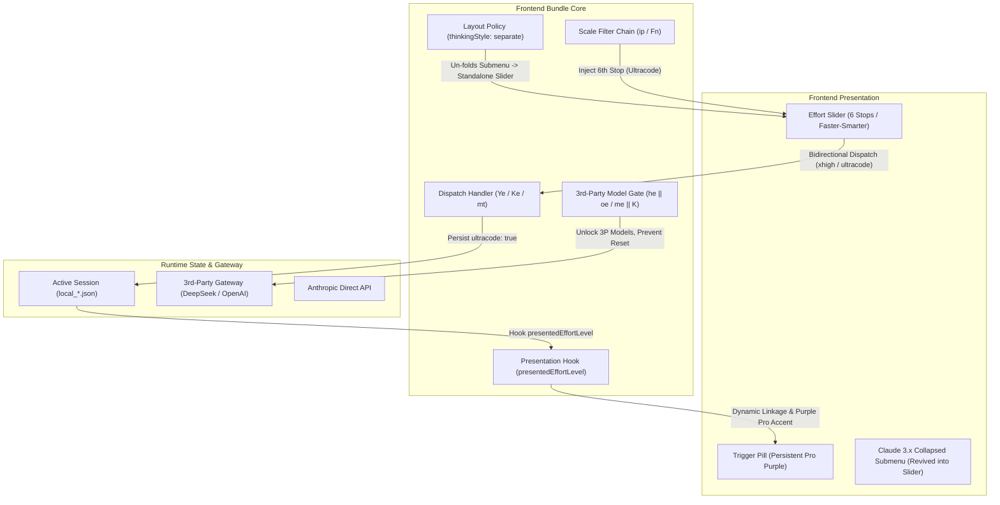

# Claude Desktop: Ultracode Restoration & Slider Revival Engine

> **A cross-version AST patcher for Claude Desktop on Windows. Restores the hidden 6th Ultracode stop, un-folds the collapsed effort slider on Claude 3.x, unlocks third-party models (e.g., DeepSeek), and makes the trigger pill persistently purple.**  
> *English Documentation · [简体中文文档](README.zh-CN.md)*

[](LICENSE)
[](#quick-start)
[-black)](#ast-replacement-specification)
[](https://github.com/Zorix666/claude-ultracode-revival/releases)
[](#)

---

## Architectural Overview



---

## Background & Root Causes

When running Claude Desktop on Windows (especially with third-party gateways like DeepSeek or alongside Claude Code), users encounter several architectural issues:

1. **Claude 3.x Collapses Slider into Dropdown Submenu**:
   - In Claude Desktop 3.x (e.g. `3.6556.2`), Anthropic redesigned the bottom chin layout. It leaves `thinkingStyle` undefined for composer chins, collapsing the slider into a nested submenu.
2. **Missing 6th "Ultracode" Effort Level**:
   - While the Claude Code CLI supports `/effort ultracode`, the desktop UI truncates the slider to 5 stops (`low` ~ `max`).
3. **Silent Reset on 3rd-Party Models (DeepSeek)**:
   - For non-Anthropic models lacking the proprietary `xhigh` flag, an internal gate `_e = (he || oe)` evaluates to `false` and triggers a background reset (`Ce({ultracode: false})`).
4. **Trigger Pill Locked on "High"**:
   - The trigger button rendered in the bottom chin hardcodes `label: q(L)` or `label: H(N)`, decoupling from the slider's active selection.
5. **MSIX Automatic Update Overwrites**:
   - WindowsApps quietly replaces entire installation directories on major updates, wiping manual patches.

---

## Solutions Provided

- **Forces Standalone Slider**: Overrides `thinkingStyle: "separate"` across all composer placements to permanently revive the slider.
- **Injects 6th Stop**: Dynamically extends the model option filter chain to include `{id: "ultracode", name: "Ultracode"}` with native `font-medium text-pro` purple styling.
- **Bypasses 3P Model Gate**: Disables model gating so DeepSeek and OpenAI-compatible proxies retain Ultracode.
- **Synchronizes Trigger Pill**: Dynamically binds the trigger pill label and purple accent to the active Ultracode state.
- **Idempotent Self-Elevating Installer**: Automatically handles Windows UAC elevation, process termination, ACL unlocks, and version detection.

---

## AST Replacement Specification (v2.x & v3.x)

| Target | File Pattern | Original (Old) | Patched |
| :--- | :--- | :--- | :--- |
| **Slider Revival** | `c227f4d5e-*.js` | `w$={shortcuts:!0}` | `w$={shortcuts:!0,thinkingStyle:"separate"}` |
| **6th Stop Injection** | `c227f4d5e-*.js` | `let i=e.filter(...)` | `let i=[...e.filter(...),{id:"ultracode",name:"Ultracode"}],a=i;` |
| **Bidirectional Dispatch** | `c9543da06-*.js` | `(e,t)=>mt(e,!1,{...})` | `(e,t)=>e==="ultracode"?mt("xhigh",!0,{...}):mt(e,!1,{...})` |
| **3P Model Gate Bypass** | `c9543da06-*.js` | `&&(me\|\|K)&&` / `&&(he\|\|oe)&&` | `&&(!0)&&` |
| **Presentation Hook** | `c9543da06-*.js` | `wt=pe?Y:null` / `tt=G?pe:null` | `wt=pe?(ye\|\|_e\|\|Y==="xhigh"?"ultracode":Y):null` |
| **Trigger Pill Linkage** | `c8e04f916-*.js` | `label:H(N)` / `label:q(L)` | `label:(I===g.length-1\|\|...?"Ultracode":H(N))` |

---

## Quick Start

### Option 1: Download Release (Recommended)

1. Go to the [Releases](https://github.com/Zorix666/claude-ultracode-revival/releases) page and download `claude-ultracode-revival.zip`.
2. Extract the archive and double-click **`patch_ultracode.bat`**.
3. Accept the Windows UAC elevation prompt. The script will patch the bundle and restart Claude in under 1 second.

### Option 2: Clone & Run

```bash
git clone https://github.com/Zorix666/claude-ultracode-revival.git
cd claude-ultracode-revival
python apply_patch.py
```

---

## Compatibility Matrix

- [x] **Claude Desktop v3.6556.2+** (Latest Claude 3.x, restores collapsed slider)
- [x] **Claude Desktop v2.42304+** (Classic v2.x, unlocks 6th stop)
- [x] **Claude Desktop v2.31226+**
- [x] **3rd-Party Gateway Support**: DeepSeek, OpenAI-compatible relays, direct APIs
- [x] **Operating System**: Windows 11 / Windows 10 (x64)

---

## License

This project is licensed under the [MIT License](LICENSE).
