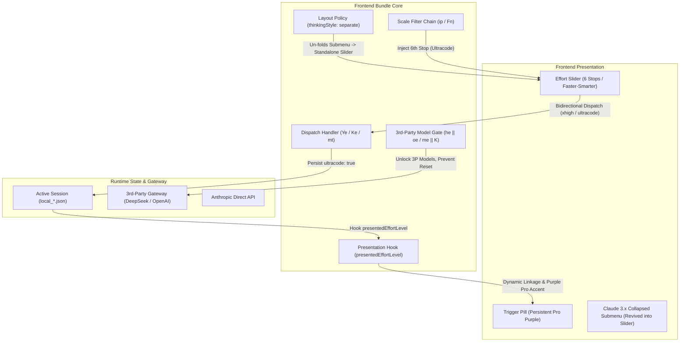

# Claude Desktop: Ultracode Restoration & Slider Revival Engine

> **A cross-version AST patcher for Claude Desktop on Windows. Restores the hidden 6th Ultracode stop, un-folds the collapsed effort slider on Claude 3.x, unlocks third-party models (e.g., DeepSeek), and makes the trigger pill persistently purple.**  
> *English Documentation · [简体中文文档](README.zh-CN.md)*

[](LICENSE)
[](#quick-start)
[](#compatibility-matrix)
[](https://github.com/Zorix666/claude-ultracode-revival/releases)
[](#)

---

## Architectural Overview



---

## Background & Root Causes

When running Claude Desktop on Windows (especially with third-party gateways like DeepSeek or alongside Claude Code), users encounter several architectural issues:

1. **Claude 3.x Collapses Slider into Dropdown Submenu**:
   - In Claude Desktop 3.x (e.g. `3.6556.2`), Anthropic redesigned the bottom chin layout. It leaves `thinkingStyle` undefined for composer chins, collapsing the slider into a nested submenu.
2. **Missing 6th "Ultracode" Effort Level**:
   - While the Claude Code CLI supports `/effort ultracode`, the desktop UI truncates the slider to 5 stops (`low` ~ `max`).
3. **Silent Reset on 3rd-Party Models (DeepSeek)**:
   - For non-Anthropic models lacking the proprietary `xhigh` flag, an internal gate `_e = (he || oe)` evaluates to `false` and triggers a background reset (`Ce({ultracode: false})`).
4. **Trigger Pill Locked on "High"**:
   - The trigger button rendered in the bottom chin hardcodes `label: q(L)` or `label: H(N)`, decoupling from the slider's active selection.
5. **MSIX Automatic Update Overwrites**:
   - WindowsApps quietly replaces entire installation directories on major updates, wiping manual patches.

---

## Solutions Provided

- **Forces Standalone Slider**: Overrides `thinkingStyle: "separate"` across all composer placements to permanently revive the slider.
- **Injects 6th Stop**: Dynamically extends the model option filter chain to include `{id: "ultracode", name: "Ultracode"}` with native `font-medium text-pro` purple styling.
- **Bypasses 3P Model Gate**: Disables model gating so DeepSeek and OpenAI-compatible proxies retain Ultracode.
- **Synchronizes Trigger Pill**: Dynamically binds the trigger pill label and purple accent to the active Ultracode state.
- **Idempotent Self-Elevating Installer**: Automatically handles Windows UAC elevation, process termination, ACL unlocks, and version detection.

---

## AST Replacement Specification (v2.x & v3.x)

| Target | File Pattern | Original (Old) | Patched |
| :--- | :--- | :--- | :--- |
| **Slider Revival** | `c227f4d5e-*.js` | `w$={shortcuts:!0}` | `w$={shortcuts:!0,thinkingStyle:"separate"}` |
| **6th Stop Injection** | `c227f4d5e-*.js` | `let i=e.filter(...)` | `let i=[...e.filter(...),{id:"ultracode",name:"Ultracode"}],a=i;` |
| **Bidirectional Dispatch** | `c9543da06-*.js` | `(e,t)=>mt(e,!1,{...})` | `(e,t)=>e==="ultracode"?mt("xhigh",!0,{...}):mt(e,!1,{...})` |
| **3P Model Gate Bypass** | `c9543da06-*.js` | `&&(me\|\|K)&&` / `&&(he\|\|oe)&&` | `&&(!0)&&` |
| **Presentation Hook** | `c9543da06-*.js` | `wt=pe?Y:null` / `tt=G?pe:null` | `wt=pe?(ye\|\|_e\|\|Y==="xhigh"?"ultracode":Y):null` |
| **Trigger Pill Linkage** | `c8e04f916-*.js` | `label:H(N)` / `label:q(L)` | `label:(I===g.length-1\|\|...?"Ultracode":H(N))` |

---

## Claude 5.x (asar) Mode

Starting with 5.x the frontend ships as a **single `ion-dist.asar`** instead of an unpacked
`ion-dist/assets/v1/` directory. Editing individual `.js` files no longer works, so 5.x has its
own pipeline: unpack → replace byte strings → repack → sync the hash embedded in `claude.exe`.

```bash
# 1. Point at the ORIGINAL (unpatched) files from the installed package
python build_asar.py --asar "<install>\app\resources\ion-dist.asar" \
                     --exe  "<install>\app\claude.exe"

# 2. Install (auto-elevates, health-checks for 40s, rolls back on failure)
python install_asar.py
```

The build refuses to finish if any target string is missing or ambiguous, and every patched
module must pass `node --check` before a single byte is written.

| Target | Module | Change |
| :--- | :--- | :--- |
| Slider mode | `shared-8` | `thinkingStyle:"inline"/"submenu"` → `"separate"` |
| 6th stop | `shared-36` / `shared-222` | append `{id:"ultra",name:"Ultracode"}` |
| Stop whitelists | `shared-4`, `shared-192`, `shared-0`, `cd4f82e77`, `c325ea79a` | add `"ultra"` (5 modules — miss one and the slider snaps back) |
| State clamp | `cc2521586`, `shared-33` | let `ultra` through the clamp and the session marker |
| Bottom pill | `c82492f2c`, `cc43287c9` | always render the standalone Effort pill, kill the model-name merge |
| Panel | `c8e04f916` | `w-[220px]` → `w-[260px]`, accent keys off `ultra` |

### Colours

The pill and the panel title must both resolve to the **same CSS variable**:

```js
color: "var(--cds-text-pro)"   // .text-pro → violet-600 #5437B8 (light) / violet-300 (dark)
```

Hard-coding a hex value, or using `--cds-violet-450` (`#785EE8`), makes the bottom pill visibly
brighter than the panel title. The project deliberately ships **no glow, no border, no background
tint** — glowing variants were tried and rejected.

### asar repacking rules

Three things must hold, or the app white-screens with an error that points nowhere near the cause:

1. **`offset` must be a string.** The Chromium C++ side reads it with `FindString("offset")`;
   an integer makes it return `nullptr` and every file becomes `ENOENT` — even `index.html`.
2. **Pickle header**: `f0=4`, `f1=4+f2`, `f2=4+padded_json_len`, `f3=json_len`, data starts at `8+f1`.
3. **`integrity`**: update `integrity.hash` **and** `integrity.blocks` (chunked by `blockSize`).

The header's sha256 is embedded in `claude.exe`; repacking without patching it back in gets you a
silent instant exit.

---

## Quick Start

### Option 1: Download Release (Recommended)

1. Go to the [Releases](https://github.com/Zorix666/claude-ultracode-revival/releases) page and download `claude-ultracode-revival.zip`.
2. Extract the archive and double-click **`patch_ultracode.bat`**.
3. Accept the Windows UAC elevation prompt. The script will patch the bundle and restart Claude in under 1 second.

### Option 2: Clone & Run

```bash
git clone https://github.com/Zorix666/claude-ultracode-revival.git
cd claude-ultracode-revival
python apply_patch.py
```

---

## Compatibility Matrix

- [x] **Claude Desktop 5.11492.5.0** (asar mode — `build_asar.py` / `install_asar.py`)
- [x] **Claude Desktop v3.6556.2+** (Latest Claude 3.x, restores collapsed slider)
- [x] **Claude Desktop v2.42304+** (Classic v2.x, unlocks 6th stop)
- [x] **Claude Desktop v2.31226+**
- [x] **3rd-Party Gateway Support**: DeepSeek, OpenAI-compatible relays, direct APIs
- [x] **Operating System**: Windows 11 / Windows 10 (x64)

Other versions will fail loudly at the first unmatched target string — that is intentional.
Re-locating the patch points is a 10-minute job; silently producing a half-patched bundle is not.

## Known Pitfalls

These all cost real debugging time; they are documented so you don't pay for them twice.

| Symptom | Cause |
| :--- | :--- |
| Patch reports success, UI unchanged | Multiple version directories coexist and the patch went into one that is not running. Resolve the install path from the **running process**, never from directory mtime. |
| Patched client won't start or starts with an empty session list | Launched via `explorer.exe <dir>\app\claude.exe` instead of the package identity. Use `explorer.exe shell:AppsFolder\Claude_pzs8sxrjxfjjc!Claude`. |
| White screen, `ENOENT` for every asset | asar `offset` written as an integer instead of a string. |
| Instant exit after install | `integrity.blocks` not recomputed alongside `integrity.hash`. |
| Patch silently reverts after a reboot | A login guard task re-applies a stale build. Update the guard's target directory **and** its expected hash together. |

---

## License

This project is licensed under the [MIT License](LICENSE).
