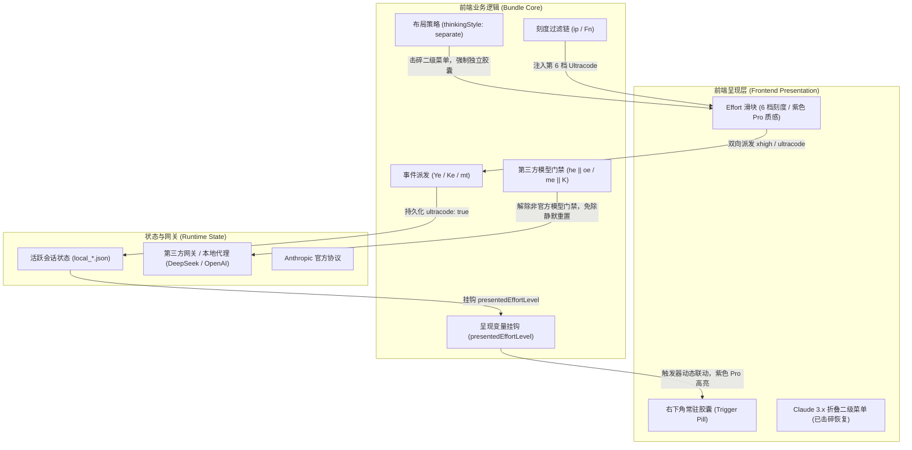

# Claude Desktop: Ultracode 档位永久固化与滑块复活器

> **攻破 Claude Desktop 架构重写、折叠菜单收缩、事件分发覆盖、模型元数据过滤、底层降级与 Windows MSIX 自动升级重置的跨版本 AST 自适应永久固化引擎**  
> *[English Documentation](README.md) · 简体中文文档*

[](LICENSE)
[](#快速开始)
[](#兼容性与验证矩阵)
[](https://github.com/Zorix666/claude-ultracode-revival/releases)
[](#)

---

## 架构演进与链路全景



---

## 核心痛点与现象复现

在 Windows 平台使用 Claude Desktop（尤其配合第三方网关如 DeepSeek、或跨版本使用 Claude Code）时，官方前端存在以下深层缺陷：

1. **Claude 3.x（3.6556.2+）官方干掉滑块，收缩为折叠二级菜单**：
   - 官方在 Claude 3.x 更新中重构了底栏策略（`thinkingStyle`），默认未指定 `separate`，导致 Effort 滑块被收进 ModelSelector 作为一个横向折叠列表（Dropdown Submenu），原汁原味的滑块胶囊直接消失。
2. **终端 CLI 与 UI 档位断层**：
   - Claude Code 终端原生支持 `/effort ultracode` 高阶推理；但桌面端 UI 原生仅开放 5 个档位（`low` ~ `max`），缺失官方最高档第 6 档 `Ultracode`。
3. **第三方模型（DeepSeek 等）静默剥夺重置**：
   - 当会话接入 DeepSeek 等第三方模型时，由于元数据中缺少官方 `xhigh`，系统门禁 `_e = (he || oe)` 会判定不支持，并在会话监听中主动触发静默重置（`Ce({ultracode: false})`），将用户好不容易拉上的 Ultracode 瞬间抹平。
4. **胶囊触发器（Trigger Pill）死锁显示为 High**：
   - 在底栏渲染层，右下角胶囊写死了 `label: q(L)`，无论滑块如何拖拽，胶囊永远定格为 `High`，浮窗与底栏严重脱节。
5. **MSIX 自动静默更新覆盖**：
   - WindowsApps 商店服务会在后台无声无息推送大版本安装，旧目录被废弃，所有传统手工修改全数归零失效。

---

## 底层原理与关键修复链

本工具通过对 Electron 渲染源 Bundle 与 React 内部状态的精准逆向，一次性闭环解决所有 5 重卡点：

### 1. 强制激活全场景独立滑块模式（击碎 3.x 折叠菜单）
- **根因**：组件配置函数 `A$(e, t, n)` 在判断底栏 `chin` / `row` 时返回了无 `thinkingStyle` 的配置 `w$`，导致 `ModelSelector` 将 Effort 当做子菜单渲染。
- **修复**：将配置强制提升为 `{ shortcuts: !0, thinkingStyle: "separate" }`，促使 Effort 永远以独立的滑块浮窗（`EffortControl`）展示在底栏。

### 2. 刻度链注入第 6 档 Ultracode
- **根因**：模型选项过滤器 `e.filter(...)` 依据 `ri(e.id)` 拦截，但元数据未下发 `ultracode`，刻度被截断为 5 档。
- **修复**：在过滤链末端自动补齐 `{id: "ultracode", name: "Ultracode"}`，滑块拥有完整的第 6 档刻度，且继承官方专有的 `font-medium text-pro` 紫色高亮与网格动态滤镜。

### 3. 解除第三方模型门禁拦截（支持 DeepSeek 等）
- **根因**：门禁条件 `_e = G && ... && (he || oe) && ge`（或 3.x 中的 `me || K`）要求模型必须原生带 `xhigh`，非官方模型一律判定为不支持并静默重置。
- **修复**：将门禁逻辑改写为全面放行 `(!0)`，DeepSeek、OpenAI 等所有 3p 接入模型均能稳定锁定并持久化 Ultracode。

### 4. 双向交互派发与呈现挂钩
- **根因**：滑块选择时事件处理器默认将 `ultracode` 标记写死为 `false`；状态挂钩只读 `pe`。
- **修复**：在用户选定 `ultracode` 时向上派发 `{ effortLevel: "xhigh", ultracode: true }`，并将呈现变量 `wt` / `tt` 挂钩至会话激活状态。

### 5. 胶囊 Trigger 实时联动与紫色高亮
- **根因**：底层渲染容器调用 `renderTrigger({label})` 时写死传入未联动的外部状态。
- **修复**：将 label 升级为状态感知表达式：
  ```javascript
  label: (I === g.length - 1 || F?.id === "ultracode" || _ === "ultracode" || _ === "xhigh" ? "Ultracode" : H(N))
  ```
  并为 Trigger 药丸外层容器挂载 `font-medium text-pro`，选定 Ultracode 时底栏胶囊常驻显示为**高贵的紫色 Ultracode**。

---

## 全架构 AST 替换规范 (v2.x & v3.x)

| 目标层 | 目标文件特征 | 原版逻辑 (Old) | 注入逻辑 (Patched) |
| :--- | :--- | :--- | :--- |
| **滑块恢复** | `c227f4d5e-*.js` | `w$={shortcuts:!0}` | `w$={shortcuts:!0,thinkingStyle:"separate"}` |
| **第 6 档刻度** | `c227f4d5e-*.js` | `let i=e.filter(...)` | `let i=[...e.filter(...),{id:"ultracode",name:"Ultracode"}],a=i;` |
| **双向交互派发** | `c9543da06-*.js` | `(e,t)=>mt(e,!1,{...})` | `(e,t)=>e==="ultracode"?mt("xhigh",!0,{...}):mt(e,!1,{...})` |
| **第三方模型放行** | `c9543da06-*.js` | `&&(me\|\|K)&&` / `&&(he\|\|oe)&&` | `&&(!0)&&` |
| **呈现变量挂钩** | `c9543da06-*.js` | `wt=pe?Y:null` / `tt=G?pe:null` | `wt=pe?(ye\|\|_e\|\|Y==="xhigh"?"ultracode":Y):null` |
| **胶囊实时联动** | `c8e04f916-*.js` | `label:H(N)` / `label:q(L)` | `label:(I===g.length-1\|\|...?"Ultracode":H(N))` |

---

## Claude 5.x（asar 形态）

从 5.x 起，前端不再是解包的 `ion-dist/assets/v1/` 目录，而是单个 **`ion-dist.asar`**。
改单个 `.js` 文件这条路走不通，5.x 走另一条流水线：解包 → 替换字节串 → 重打包 → 同步 `claude.exe` 里内嵌的哈希。

```bash
# 1. 指向安装目录里的【原件】（未打补丁的那份）
python build_asar.py --asar "<install>\app\resources\ion-dist.asar" ^
                     --exe  "<install>\app\claude.exe"

# 2. 安装（自动提权，40 秒健康检查，失败自动回滚）
python install_asar.py
```

构建器对每个补丁点做唯一性断言，并对每个改过的模块跑 `node --check`，
任何一个不通过就**一个字节都不写**。

| 目标 | 模块 | 改动 |
| :--- | :--- | :--- |
| 滑块模式 | `shared-8` | `thinkingStyle:"inline"/"submenu"` → `"separate"` |
| 第 6 档 | `shared-36` / `shared-222` | 追加 `{id:"ultra",name:"Ultracode"}` |
| 档位白名单 | `shared-4`、`shared-192`、`shared-0`、`cd4f82e77`、`c325ea79a` | 加 `"ultra"`（**共 5 处，漏一处就会拖到末档弹回 Extra**） |
| 状态钳制 | `cc2521586`、`shared-33` | 放行 `ultra`，关卡后不被重置 |
| 底栏药丸 | `c82492f2c`、`cc43287c9` | 恒渲染独立 Effort 胶囊，掐掉与模型名合体 |
| 面板 | `c8e04f916` | `w-[220px]` → `w-[260px]`，accent 判定改认 `ultra` |

### 配色

胶囊和面板标题必须解析到**同一个 CSS 变量**：

```js
color: "var(--cds-text-pro)"   // .text-pro → violet-600 #5437B8（浅色）/ violet-300（深色）
```

写死十六进制、或改用 `--cds-violet-450`（`#785EE8`），底栏会明显比面板标题亮。
本项目**刻意不加任何光晕、边框、底色** —— 带发光的版本试过，已被否决。

### asar 重打包的三条铁律

写错任何一条都会白屏，而且报错信息完全指不到真正的原因：

1. **`offset` 必须是字符串**。C++ 侧用 `FindString("offset")` 取值，写成整数会返回 `nullptr`，
   所有文件瞬间变成 `ENOENT`，连 `index.html` 都读不到。
2. **Pickle 头四字段**：`f0=4`、`f1=4+f2`、`f2=4+padded_json_len`、`f3=json_len`，数据区从 `8+f1` 开始。
3. **`integrity` 要成对更新**：`integrity.hash` 和 `integrity.blocks`（按 `blockSize` 分块）缺一不可。

另外，header 的 sha256 是内嵌在 `claude.exe` 里的，重打包后不同步替换，客户端会静默秒退。

---

## Claude 4.23118（Electron 独立版）

这是**另一条发行渠道**：装在 `%LOCALAPPDATA%\Programs\Claude`，而不是
`C:\Program Files\WindowsApps`；版本号自成一套（4.23xxx，与 MSIX 的 5.x/6.x 毫无关系），
模块名也完全不同。

目录结构少一层 `app\`：

```
<root>\resources\ion-dist.asar
<root>\claude.exe
```

**从运行中的进程反查安装路径**——两个渠道共存时，目录列表和 mtime 都会骗人：

```powershell
Get-CimInstance Win32_Process -Filter "Name='claude.exe'" |
  Select-Object ProcessId, ExecutablePath | Format-List
```

```bash
# 1. 构建，输入必须是「未打补丁」的原件（即 .bak 副本）
python build_asar_v4.py --asar "<root>\resources\ion-dist.asar.bak" \
                        --exe  "<root>\claude.exe.bak" \
                        --out  build/v4

# 2. 安装（用户目录，无需提权）
python install_electron.py --build build/v4
```

| 目标 | 模块 | 改动 |
| :--- | :--- | :--- |
| 滑块形态 | `shared-8` | `thinkingStyle:"inline"/"submenu"` → `"separate"` |
| 场景配置 | `c227f4d5e` | `case"chin"/"row"` 返回 separate 预设，而不是裸 `HR` |
| 第 6 档 | `shared-8` 的 `Vb`、`shared-7` 的 `GV()` | `Vb` 是 zod 枚举的唯一源头，改它整条链路自动放行 |
| 档位白名单 | `shared-0`、`shared-196`、`shared-4`、`cd4f82e77`、`c227f4d5e` | 追加 `"ultracode"` |
| 底栏胶囊 | `cc43287c9` | 恒渲染、掐掉模型名拼接、纯紫文字 |
| 面板 | `c8e04f916` | `w-[220px]` → `w-[260px]`，摘掉独立 Toggle 行 |

### 谁决定「列表还是滑块」

由 `c227f4d5e` 里一个函数决定：

```js
var zR={shortcuts:!0,thinkingStyle:"separate"}, BR=zR, VR={…zR,overflowSearch:!0},
    HR={shortcuts:!0}, WR={…HR,overflowStyle:"inline",thinkingStyle:"inline"}, …

function YR(e,t,n){switch(e){
  case"chin":case"row":return n?t?GR:WR:t?UR:HR;   // HR 无 thinkingStyle → submenu → 列表
  case"titlebar":return t?JR:qR;
  case"rail":return t?VR:BR;                        // separate → 滑块
  case"composer":return t?VR:zR}}
```

输入框下方的环境栏正是 `chin`/`row`，所以拿到 `HR`、渲染成列表。
改成返回 separate 预设才会出现滑块。

### 为什么这一代的第 6 档用 `"ultracode"` 而不是 `"ultra"`

这个版本**原生就认 `"ultracode"`**，直接复用它比自造 `"ultra"` 再逐个手补消费方划算：

| 位置 | 代码 | 用 `"ultra"` 时还得补 |
| :--- | :--- | :--- |
| `shared-33` | `var fT="ultracode"; function pT(e){return e===fT}` | `\|\|e==="ultra"` |
| `shared-7` | `m=t.id==="ultracode"?"text-pro font-medium":void 0` | `\|\|t.id==="ultra"` |
| `c10f0af0c` | `EX(e){if(e===void 0\|\|e==="ultracode")return e; let t=Ud.safeParse(e);…}` | 同样要放行 |

`EX()` 在 `safeParse` 之前抢先放行，恰恰说明 **zod schema 本身并不接受 `"ultracode"`**——
所以 schema 源头 `Vb` 必须在同一次补丁里一起扩。

---

## 快速开始

本工具采用纯 Python + Windows 原生 API 编写，内置 Windows UAC 管理员自动提权、自动探测当前最新活跃版本、解除 ACL 保护、幂等注入与自动重启。

### 方式一：下载 Release 运行（推荐）

1. 前往 [Releases 页面](https://github.com/Zorix666/claude-ultracode-revival/releases) 下载最新版本的 `claude-ultracode-revival.zip`；
2. 解压后，双击运行 **`patch_ultracode.bat`**；
3. 弹出 UAC 提权提示时点击“是”，脚本将在 1 秒内完成自适应固化并自动重新打开 Claude。

### 方式二：克隆源码运行

```bash
git clone https://github.com/Zorix666/claude-ultracode-revival.git
cd claude-ultracode-revival
python apply_patch.py
```

---

## 兼容性与验证矩阵

- [x] **Claude Desktop 5.11492.5.0**（asar 形态，走 `build_asar.py` / `install_asar.py`）
- [x] **Claude Desktop 4.23118.x**（Electron 独立版，走 `build_asar_v4.py` / `install_electron.py`）
- [x] **Claude Desktop v3.6556.2+**（Claude 3.x，完美恢复被折叠的滑块）
- [x] **Claude Desktop v2.42304+**（经典版本，完美固化 6 档）
- [x] **Claude Desktop v2.31226+**
- [x] **第三方网关兼容**：DeepSeek 全系列、OpenAI 协议中继、Claude 官方 Direct API
- [x] **系统环境**：Windows 11 / Windows 10 (x64)

其它版本会在第一个不匹配的目标串处**直接失败** —— 这是刻意的。
重新定位补丁点是十分钟的活；悄悄产出一个只打了一半的包不是。

## 已知坑（都是真金白银踩出来的）

| 现象 | 原因 |
| :--- | :--- |
| 日志显示成功，界面毫无变化 | **两个发行渠道并存**：`WindowsApps\Claude_<ver>` 的 MSIX 版，和 `%LOCALAPPDATA%\Programs\Claude` 的 Electron 独立版。两个都能装着，只有一个在跑——补丁多半打进了没在跑的那个。安装路径必须从**正在运行的进程**（`Get-CimInstance Win32_Process`）反查，不能按目录 mtime 取最新；而且两条渠道的版本号体系互不相干，比版本号也推不出来。 |
| 独立版打完起不来 / 白屏 | 构建输入必须是 `.bak` 原件。拿已经打过补丁的 `ion-dist.asar` 当输入，产出的包与新拷过去的 `claude.exe` 内嵌 header 哈希对不上。 |
| 守卫什么都不做，或日志全是乱码 | 计划任务跑的是 `pythonw.exe`（GUI 子系统），`sys.stdout` 为 `None`，裸 `print()` 会抛 `AttributeError` 把脚本带崩——必须 `try/except`。日志首次创建要写 UTF-8 **BOM**，Windows 工具会把无 BOM 的 UTF-8 按 GBK 解。 |
| 守卫把刚升级的新版本盖成旧版 | 只要 hash 不等就重装，等于上游一升级就拿旧构建盖新 JS。必须加 `orig_hash` 白名单：只有当前 header 等于原版才打补丁，其余一律判定为版本漂移、大声跳过。 |
| 守卫把另一个 Claude 窗口也杀了 | `taskkill /im claude.exe` 会同时命中两个渠道——它们的内嵌 exe 同名。必须按完整路径杀：`Get-Process claude \| Where-Object { $_.Path -eq '<exe>' } \| Stop-Process -Force`。 |
| 打完客户端起不来，或起来后会话列表全空 | 用 `explorer.exe <dir>\app\claude.exe` 拉起，绕过了 MSIX 包身份。要走 `explorer.exe shell:AppsFolder\Claude_pzs8sxrjxfjjc!Claude`。 |
| 白屏，所有资源报 `ENOENT` | asar 的 `offset` 写成了整数，没有写成字符串。 |
| 装完立刻退出 | 只改了 `integrity.hash`，没重算 `integrity.blocks`。 |
| 重启后补丁自动变回旧版 | 开机守卫任务在重装它记着的旧构建。**改构建目录时，目标 hash 必须一起改**。 |

---

## 开源许可证 (License)

本项目基于 [MIT License](LICENSE) 许可协议开源。
