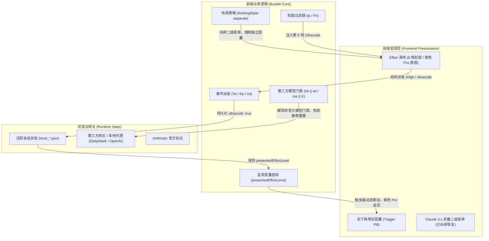

# Claude Desktop: Ultracode 档位永久固化与滑块复活器

> **攻破 Claude Desktop 架构重写、折叠菜单收缩、事件分发覆盖、模型元数据过滤、底层降级与 Windows MSIX 自动升级重置的跨版本 AST 自适应永久固化引擎**  
> *[English Documentation](README.md) · 简体中文文档*

[](LICENSE)
[](#快速开始)
[-black)](#全架构-ast-替换规范)
[](https://github.com/Zorix666/claude-ultracode-revival/releases)
[](#)

---

## 架构演进与链路全景



---

## 核心痛点与现象复现

在 Windows 平台使用 Claude Desktop（尤其配合第三方网关如 DeepSeek、或跨版本使用 Claude Code）时，官方前端存在以下深层缺陷：

1. **Claude 3.x（3.6556.2+）官方干掉滑块，收缩为折叠二级菜单**：
   - 官方在 Claude 3.x 更新中重构了底栏策略（`thinkingStyle`），默认未指定 `separate`，导致 Effort 滑块被收进 ModelSelector 作为一个横向折叠列表（Dropdown Submenu），原汁原味的滑块胶囊直接消失。
2. **终端 CLI 与 UI 档位断层**：
   - Claude Code 终端原生支持 `/effort ultracode` 高阶推理；但桌面端 UI 原生仅开放 5 个档位（`low` ~ `max`），缺失官方最高档第 6 档 `Ultracode`。
3. **第三方模型（DeepSeek 等）静默剥夺重置**：
   - 当会话接入 DeepSeek 等第三方模型时，由于元数据中缺少官方 `xhigh`，系统门禁 `_e = (he || oe)` 会判定不支持，并在会话监听中主动触发静默重置（`Ce({ultracode: false})`），将用户好不容易拉上的 Ultracode 瞬间抹平。
4. **胶囊触发器（Trigger Pill）死锁显示为 High**：
   - 在底栏渲染层，右下角胶囊写死了 `label: q(L)`，无论滑块如何拖拽，胶囊永远定格为 `High`，浮窗与底栏严重脱节。
5. **MSIX 自动静默更新覆盖**：
   - WindowsApps 商店服务会在后台无声无息推送大版本安装，旧目录被废弃，所有传统手工修改全数归零失效。

---

## 底层原理与关键修复链

本工具通过对 Electron 渲染源 Bundle 与 React 内部状态的精准逆向，一次性闭环解决所有 5 重卡点：

### 1. 强制激活全场景独立滑块模式（击碎 3.x 折叠菜单）
- **根因**：组件配置函数 `A$(e, t, n)` 在判断底栏 `chin` / `row` 时返回了无 `thinkingStyle` 的配置 `w$`，导致 `ModelSelector` 将 Effort 当做子菜单渲染。
- **修复**：将配置强制提升为 `{ shortcuts: !0, thinkingStyle: "separate" }`，促使 Effort 永远以独立的滑块浮窗（`EffortControl`）展示在底栏。

### 2. 刻度链注入第 6 档 Ultracode
- **根因**：模型选项过滤器 `e.filter(...)` 依据 `ri(e.id)` 拦截，但元数据未下发 `ultracode`，刻度被截断为 5 档。
- **修复**：在过滤链末端自动补齐 `{id: "ultracode", name: "Ultracode"}`，滑块拥有完整的第 6 档刻度，且继承官方专有的 `font-medium text-pro` 紫色高亮与网格动态滤镜。

### 3. 解除第三方模型门禁拦截（支持 DeepSeek 等）
- **根因**：门禁条件 `_e = G && ... && (he || oe) && ge`（或 3.x 中的 `me || K`）要求模型必须原生带 `xhigh`，非官方模型一律判定为不支持并静默重置。
- **修复**：将门禁逻辑改写为全面放行 `(!0)`，DeepSeek、OpenAI 等所有 3p 接入模型均能稳定锁定并持久化 Ultracode。

### 4. 双向交互派发与呈现挂钩
- **根因**：滑块选择时事件处理器默认将 `ultracode` 标记写死为 `false`；状态挂钩只读 `pe`。
- **修复**：在用户选定 `ultracode` 时向上派发 `{ effortLevel: "xhigh", ultracode: true }`，并将呈现变量 `wt` / `tt` 挂钩至会话激活状态。

### 5. 胶囊 Trigger 实时联动与紫色高亮
- **根因**：底层渲染容器调用 `renderTrigger({label})` 时写死传入未联动的外部状态。
- **修复**：将 label 升级为状态感知表达式：
  ```javascript
  label: (I === g.length - 1 || F?.id === "ultracode" || _ === "ultracode" || _ === "xhigh" ? "Ultracode" : H(N))
  ```
  并为 Trigger 药丸外层容器挂载 `font-medium text-pro`，选定 Ultracode 时底栏胶囊常驻显示为**高贵的紫色 Ultracode**。

---

## 全架构 AST 替换规范 (v2.x & v3.x)

| 目标层 | 目标文件特征 | 原版逻辑 (Old) | 注入逻辑 (Patched) |
| :--- | :--- | :--- | :--- |
| **滑块恢复** | `c227f4d5e-*.js` | `w$={shortcuts:!0}` | `w$={shortcuts:!0,thinkingStyle:"separate"}` |
| **第 6 档刻度** | `c227f4d5e-*.js` | `let i=e.filter(...)` | `let i=[...e.filter(...),{id:"ultracode",name:"Ultracode"}],a=i;` |
| **双向交互派发** | `c9543da06-*.js` | `(e,t)=>mt(e,!1,{...})` | `(e,t)=>e==="ultracode"?mt("xhigh",!0,{...}):mt(e,!1,{...})` |
| **第三方模型放行** | `c9543da06-*.js` | `&&(me\|\|K)&&` / `&&(he\|\|oe)&&` | `&&(!0)&&` |
| **呈现变量挂钩** | `c9543da06-*.js` | `wt=pe?Y:null` / `tt=G?pe:null` | `wt=pe?(ye\|\|_e\|\|Y==="xhigh"?"ultracode":Y):null` |
| **胶囊实时联动** | `c8e04f916-*.js` | `label:H(N)` / `label:q(L)` | `label:(I===g.length-1\|\|...?"Ultracode":H(N))` |

---

## 快速开始

本工具采用纯 Python + Windows 原生 API 编写，内置 Windows UAC 管理员自动提权、自动探测当前最新活跃版本、解除 ACL 保护、幂等注入与自动重启。

### 方式一：下载 Release 运行（推荐）

1. 前往 [Releases 页面](https://github.com/Zorix666/claude-ultracode-revival/releases) 下载最新版本的 `claude-ultracode-revival.zip`；
2. 解压后，双击运行 **`patch_ultracode.bat`**；
3. 弹出 UAC 提权提示时点击“是”，脚本将在 1 秒内完成自适应固化并自动重新打开 Claude。

### 方式二：克隆源码运行

```bash
git clone https://github.com/Zorix666/claude-ultracode-revival.git
cd claude-ultracode-revival
python apply_patch.py
```

---

## 兼容性与验证矩阵

- [x] **Claude Desktop v3.6556.2+**（当前最新版本，完美恢复被折叠的滑块）
- [x] **Claude Desktop v2.42304+**（经典版本，完美固化 6 档）
- [x] **Claude Desktop v2.31226+**
- [x] **第三方网关兼容**：DeepSeek 全系列、OpenAI 协议中继、Claude 官方 Direct API
- [x] **系统环境**：Windows 11 / Windows 10 (x64)

---

## 开源许可证 (License)

本项目基于 [MIT License](LICENSE) 许可协议开源。
